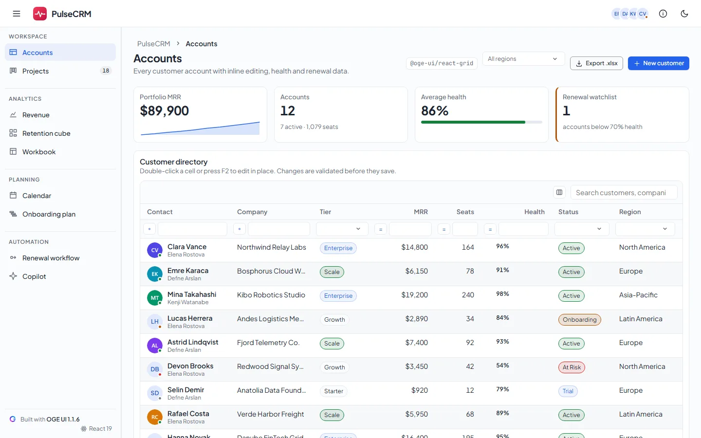

# PulseCRM — Customer success workspace built with OGE UI (React)

## 1. What the app shows

**PulseCRM** is a React 19 + TypeScript customer-success workspace built with `@oge-ui/react@1.1.6`
and the seven OGE UI React Pro packages (`1.1.6`). It is laid out like a product, not a component
gallery: one shell, nine pages, product language everywhere, and the OGE mark used once — as the
brand in the header.

**Shell** (`<OgeAppBar>`, `<OgeDrawer mode="side" size={250} minSize={64}>`)

- Header: menu toggle, the OGE mark (`favicon-192.png`) with the wordmark, the product name, the
  success-team avatar group and a light/dark toggle (`<html class="oge-theme-dark">`).
- Sidebar: four groups (Workspace, Analytics, Planning, Automation), accent-soft active state,
  `aria-current="page"`, a live task count on Projects, and a quiet "Built with OGE UI 1.1.6 ·
  React 19" credit. Collapsed, it becomes a 64px icon rail; below 960px it is an overlay drawer
  that starts closed.
- Every page has the same header: breadcrumb, title, one-line description, the OGE package behind
  it as a monospace chip, and the page's actions.

**Pages**

| Page | What it shows | OGE package |
| --- | --- | --- |
| Accounts | Four KPI tiles (with an `<OgeSparkline>`), the customer directory `<OgeGrid>` with inline cell editing, lookups, validation, column chooser and Excel export, the onboarding `<OgeStepper>` and the commercial-terms `<OgeAccordion>`; the "New customer" modal (`<OgeModal>` + `<OgeForm>` + avatar `<OgeFileUploader>`) and `useOgeModals().confirm` for deletes | `@oge-ui/react-grid`, `-forms`, `-navigation`, `-layout`, `-overlay`, `-upload` |
| Projects | A delivery board: open / in-progress / in-review / overdue counts, per-project progress, and `<OgeKanban>` with swimlanes per project, WIP limits, filter chips, quick add, inline title editing and checklists — plus a Board / List toggle that renders the same tasks in `<OgeGrid>` | `@oge-ui/react-kanban` |
| Revenue | `<OgeChart>` (spline area + bar + dashed spline, zoom and pan), tier doughnut (`<OgePieChart>`), customer-journey `<OgeFunnelChart>`, a renewal `<OgeCircularGauge>` and the NRR sparkline | `@oge-ui/react-charts` |
| Retention cube | `<OgePivotGrid>` with field panel, calculated measures (ARR per seat, share of ARR), three row-header layouts and Excel export | `@oge-ui/react-pivot` |
| Workbook | `<OgeSpreadsheet>` reading `.xlsx` files (tables, formulas, sparklines, multi-sheet) with a drop zone for your own workbook | `@oge-ui/react-spreadsheet`, `-upload` |
| Calendar | `<OgeScheduler>` grouped by customer success manager with six views and working hours | `@oge-ui/react-scheduler` |
| Onboarding plan | `<OgeGantt>` with WBS hierarchy, dependencies, resource workload and a critical-path switch | `@oge-ui/react-gantt` |
| Renewal workflow | `<OgeBpmnEditor>` with palette, properties panel, minimap, live lint and a validate action | `@oge-ui/react-bpmn` |
| Copilot | `<OgeChat>` over a local transport, `<OgeSmartPaste>` filling the customer form, and `<OgeGridAssistant>` driving an accounts grid | `@oge-ui/react-ai` |

**Design rules the shell follows** (see `docs/ARCHITECTURE.md` in the OGE repository): every
colour, radius, shadow and motion value is an `--oge-*` token (no literal fallbacks), app-level
`--app-nav-*` tokens are derived from them so dark mode is one class, focus is a `--oge-focus-ring`
box-shadow with a transparent outline for forced colours, transitions stop under
`prefers-reduced-motion`, and nothing scrolls sideways at 390px.

**License.** The Pro packages read their key from the `OGE_LICENSE_KEY` environment variable: `scripts/write-license.mjs` writes the git-ignored `src/license.ts` before `start` and `build`, and the entry file registers it with `ogeSetLicenseKey`. Without the variable the app runs unlicensed, which is silent on localhost.

## 2. Screenshot



## 3. How much code?

| File | Role | Lines |
| --- | --- | ---: |
| [`src/main.tsx`](./src/main.tsx) | Stylesheet imports (`@oge-ui/react/styles.css` + Pro styles) and the app-wide `<Oge<Family>ConfigProvider>` tree | 93 |
| [`src/App.tsx`](./src/App.tsx) | The shell and all nine pages | 1,397 |
| [`src/index.css`](./src/index.css) | Shell styles on top of the OGE tokens (light, dark, reduced motion, forced colours) | 739 |
| **Total OGE UI code** | | **2,229** |

*(Fictional sample data — customers, cohorts, project tasks, appointments, Gantt tasks and a BPMN
process — lives in [`src/data.ts`](./src/data.ts), 1,061 lines of plain TypeScript.)*

## 4. Run locally

```bash
npm install && npm start
```

Then open `http://localhost:5173`.

## 5. Open in StackBlitz

[](https://stackblitz.com/github/oge-ui/oge-ui/tree/main/examples/customer-manager)
