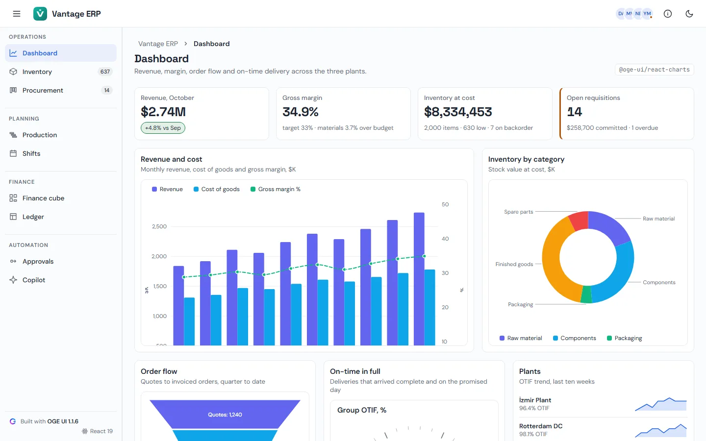

# Vantage ERP — Operations suite built with OGE UI (React)

## 1. What the app shows

**Vantage ERP** is a React 19 + TypeScript manufacturing and operations suite for a fictional
three-plant manufacturer, built with `@oge-ui/react@1.1.6` and the seven OGE UI React Pro packages
(`1.1.6`). Like the other examples it is laid out as a product: one shell, nine pages, its own
brand mark (`public/brand.svg`) and favicon set, and the OGE mark used once — in the sidebar's
"Built with OGE UI" credit.

**Shell** (`<OgeAppBar>`, `<OgeDrawer mode="side" size={250} minSize={64}>`)

- Header: menu toggle, the Vantage mark and name, the buyers' avatar group, an "About this demo"
  dialog (opens once on the first visit) and a light/dark toggle (`<html class="oge-theme-dark">`).
- Sidebar: four groups (Operations, Planning, Finance, Automation) with live counts on Inventory
  (items below reorder point) and Procurement (open requisitions). Collapsed, it becomes a 64px icon
  rail; below 960px it is an overlay drawer that starts closed.
- Every page has the same header: breadcrumb, title, one-line description, the OGE package behind
  it as a monospace chip, and the page's actions.
- Type: Space Grotesk for display, DM Sans for text, JetBrains Mono for code.

**Pages**

| Page | What it shows | OGE package |
| --- | --- | --- |
| Dashboard | Four KPI tiles, revenue / cost bars with a margin line on a second axis, inventory doughnut, order funnel, group OTIF gauge, per-plant sparklines, a stock-out risk grid and an activity timeline | `@oge-ui/react-charts`, `-grid`, `-layout` |
| Inventory | 2,000 stock items across five warehouses: filter row, grouping, column chooser, cell editing that recomputes value and stock status, totals and Excel export; a "New item" modal with a validated `<OgeForm>` | `@oge-ui/react-grid`, `-forms`, `-overlay` |
| Procurement | Purchase requisitions on `<OgeKanban>` — lanes per plant, WIP limits, filter chips, checklists, quick add — with a Board / List toggle and per-plant progress | `@oge-ui/react-kanban` |
| Production | Work orders per line on `<OgeGantt>` with dependencies, resource workload and a critical-path switch | `@oge-ui/react-gantt` |
| Shifts | Shifts, inbound / outbound slots and maintenance windows on `<OgeScheduler>`, grouped by line, timeline-week by default | `@oge-ui/react-scheduler` |
| Finance cube | Actuals against budget on `<OgePivotGrid>` with a calculated variance measure and Excel export | `@oge-ui/react-pivot` |
| Ledger | Costing workbooks on `<OgeSpreadsheet>` (formulas, tables, sparklines, multi-sheet) with a drop zone for your own `.xlsx` | `@oge-ui/react-spreadsheet`, `-upload` |
| Approvals | The purchase-approval process on `<OgeBpmnEditor>` with live validation | `@oge-ui/react-bpmn` |
| Copilot | `<OgeChat>`, `<OgeSmartPaste>` filling a supplier form, and `<OgeGridAssistant>` shaping the inventory grid | `@oge-ui/react-ai` |

The Pro packages read their license key from the `OGE_LICENSE_KEY` environment variable:
[`scripts/write-license.mjs`](./scripts/write-license.mjs) writes `src/license.ts` (git-ignored) before
`start`, `dev` and `build`, and `src/main.tsx` registers it with `ogeSetLicenseKey`. Without the
variable the app runs unlicensed, which is silent on localhost.

## 2. Screenshot



## 3. How much code?

| File | Role | Lines |
| --- | --- | ---: |
| [`src/main.tsx`](./src/main.tsx) | Stylesheet imports, license registration and the app-wide `<Oge<Family>ConfigProvider>` tree | 97 |
| [`src/App.tsx`](./src/App.tsx) | The shell and all nine pages | 1,214 |
| [`src/index.css`](./src/index.css) | Shell styles on top of the OGE tokens (light, dark, reduced motion, forced colours) | 934 |
| **Total OGE UI code** | | **2,245** |

*(Deterministic sample data — inventory generator, requisitions, work orders, shifts, ledger entries
and a BPMN process — lives in [`src/data.ts`](./src/data.ts), 560 lines of plain TypeScript.)*

## 4. Run locally

```bash
npm install && npm start
```

Then open `http://localhost:5173`. Live: <https://erp-suite-tau.vercel.app>.

## 5. Open in StackBlitz

[](https://stackblitz.com/github/oge-ui/oge-ui/tree/main/examples/erp-suite)
