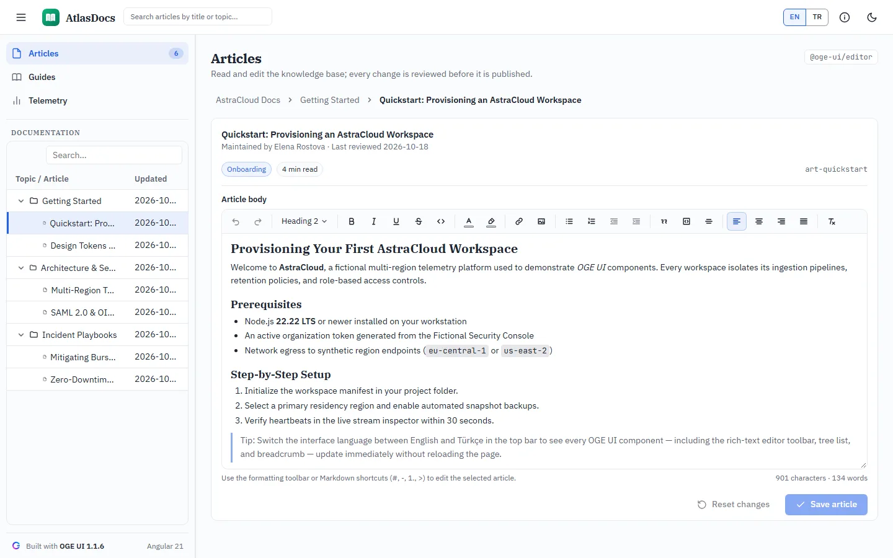

# AtlasDocs — Bilingual knowledge base built with OGE UI (Angular)

## 1. What the app shows

**AtlasDocs** is a standalone Angular 21 (zoneless + signals) documentation workspace built with
`oge-ui@1.1.6` and `@oge-ui/locales@1.1.6`. Every OGE component — the tree list, the rich-text
editor's toolbar, the breadcrumb, the grid — switches between English and Türkçe at runtime through
`provideOgeLocale(() => activeLocalePack())`, without a reload.

**Shell** (`<oge-app-bar>`, `<oge-drawer mode="side" [size]="316" [minSize]="64">`)

- Header: menu toggle, the OGE mark (`favicon-192.png`) with the wordmark, the product name, an
  `<oge-autocomplete>` article search, the EN / TR language switch (`<oge-button-group>`) and a
  light/dark toggle (`<html class="oge-theme-dark">`).
- Sidebar: three sections (Articles, Guides, Telemetry) with an article count, then the
  documentation tree — `<oge-tree-list>` with `keyExpr` / `parentIdExpr`, search panel, focused-row
  tracking and folder / article icons via `*ogeCellTemplate` — and a quiet "Built with OGE UI 1.1.6
  · Angular 21" credit. Collapsed, it becomes a 64px icon rail; below 960px it is an overlay drawer
  that starts closed.
- Every page has the same header: title, one-line description and the OGE package behind it as a
  monospace chip.

**Pages**

| Page | What it shows | OGE package |
| --- | --- | --- |
| Articles | `<oge-breadcrumb>` for the folder path, the article card with category and read-time chips, and `<oge-editor>` (formatting toolbar, Markdown shortcuts, character / word counter) with dirty-state Reset / Save actions in `[ogeCardActions]` | `@oge-ui/editor`, `@oge-ui/navigation`, `@oge-ui/layout` |
| Guides | The provisioning runbook as a horizontal `<oge-stepper>`, the architecture FAQ as `<oge-accordion>` and the release history as `<oge-timeline>` | `@oge-ui/navigation`, `@oge-ui/layout` |
| Telemetry | Readership `<oge-grid>` with search, chip and `<oge-progress-bar>` cell templates; a row click opens the article | `@oge-ui/grid` |

**Design rules the shell follows** (see `docs/ARCHITECTURE.md` in the OGE repository): every
colour, radius, shadow and motion value is an `--oge-*` token (no literal fallbacks), app-level
`--app-nav-*` tokens are derived from them so dark mode is one class, focus is a `--oge-focus-ring`
box-shadow with a transparent outline for forced colours, transitions stop under
`prefers-reduced-motion`, and nothing scrolls sideways at 390px.

**License.** AtlasDocs uses only MIT packages and needs no key; it keeps the same setup as the other examples so a Pro family can be added later. The key is read from the `OGE_LICENSE_KEY` environment variable: `scripts/write-license.mjs` writes the git-ignored `src/license.ts` before `start` and `build`, and the entry file registers it with `ogeSetLicenseKey`. Without the variable the app runs unlicensed, which is silent on localhost.

## 2. Screenshot



## 3. How much code?

| File | Role | Lines |
| --- | --- | ---: |
| [`src/app/app.config.ts`](./src/app/app.config.ts) | Reactive `provideOgeLocale(() => activeLocalePack())` wiring `en` and `tr` | 22 |
| [`src/app/app.ts`](./src/app/app.ts) | The shell and all three pages | 543 |
| [`src/styles.css`](./src/styles.css) | Shell styles on top of the OGE tokens (light, dark, reduced motion, forced colours) | 438 |
| **Total OGE UI code** | | **1,003** |

*(Bilingual sample articles and UI strings live in [`src/app/data.ts`](./src/app/data.ts), 669 lines
of plain TypeScript.)*

## 4. Run locally

```bash
npm install && npm start
```

Then open `http://localhost:4200`.

## 5. Open in StackBlitz

[](https://stackblitz.com/github/oge-ui/oge-ui/tree/main/examples/knowledge-base)
