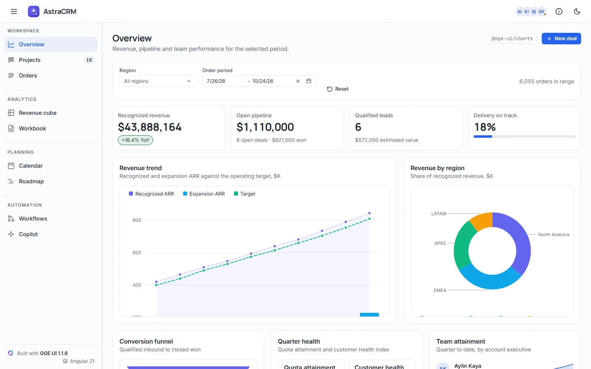

# AstraCRM — Revenue & CRM workspace built with OGE UI (Angular)

## 1. What the app shows

**AstraCRM** is a standalone Angular 21 (zoneless + signals) revenue-operations workspace built with
`oge-ui@1.1.6` and the seven OGE UI Pro packages (`1.1.6`). It is laid out like a product, not a
component gallery: one shell, nine pages, product language everywhere, and the OGE mark used once —
as the brand in the header.

**Shell** (`<oge-app-bar>`, `<oge-drawer mode="side" [size]="250" [minSize]="64">`)

- Header: menu toggle, the OGE mark (`favicon-192.png`) with the wordmark, the product name, the team
  avatar group (`<oge-avatar-group>`) and a light/dark toggle (`<html class="oge-theme-dark">`).
- Sidebar: four groups (Workspace, Analytics, Planning, Automation), accent-soft active state,
  `aria-current="page"`, a live task count on Projects, and a quiet "Built with OGE UI 1.1.6 ·
  Angular 21" credit. Collapsed, it becomes a 64px icon rail with `ogeTooltip` labels; below 960px it
  is an overlay drawer that starts closed.
- Every page has the same header: title, one-line description, the OGE package behind it as a
  monospace chip, and the page's actions.

**Pages**

| Page | What it shows | OGE package |
| --- | --- | --- |
| Overview | Region / period filters, four KPI tiles, revenue trend (`<oge-chart>` area + bar + dashed spline), region doughnut (`<oge-pie-chart>`), conversion funnel, two circular gauges, per-rep sparklines, open opportunities grid, activity timeline; the "New deal" modal (`<oge-modal>` + `<oge-form>`) | `@oge-ui/charts`, `@oge-ui/grid`, `@oge-ui/layout`, `@oge-ui/forms`, `@oge-ui/overlay` |
| Projects | A delivery board: open / in-progress / in-review / overdue counts, per-project progress, and `<oge-kanban>` with swimlanes per project, WIP limits, filter chips, quick add, inline title editing and checklists — plus a Board / List toggle that renders the same tasks in `<oge-grid>` | `@oge-ui/kanban` |
| Orders | Orders and Accounts tabs over a 10,000-row grid (filter row, group panel, multi-sort, Excel export) and the onboarding playbook (`<oge-stepper>`, `<oge-accordion>`) | `@oge-ui/grid`, `@oge-ui/tabs`, `@oge-ui/navigation` |
| Revenue cube | `<oge-pivot-grid>` with field panel, three row-header layouts, expand-all and CSV export | `@oge-ui/pivot` |
| Workbook | `<oge-spreadsheet>` reading `.xlsx` files (tables, formulas, sparklines, multi-sheet) with a drop zone for your own workbook | `@oge-ui/spreadsheet`, `@oge-ui/upload` |
| Calendar | `<oge-scheduler>` with day / week / work-week / month / agenda views and resource colours | `@oge-ui/scheduler` |
| Roadmap | `<oge-gantt>` with WBS hierarchy, dependencies, resource workload and a critical-path toggle | `@oge-ui/gantt` |
| Workflows | `<oge-bpmn-editor>` with palette, properties panel, minimap, live lint and XML export | `@oge-ui/bpmn` |
| Copilot | `<oge-chat>` over a local transport and `<oge-grid-assistant>` driving an orders grid | `@oge-ui/ai` |

**Design rules the shell follows** (see `docs/ARCHITECTURE.md` in the OGE repository): every
colour, radius, shadow and motion value is an `--oge-*` token (no literal fallbacks), app-level
`--app-nav-*` tokens are derived from them so dark mode is one class, focus is a `--oge-focus-ring`
box-shadow with a transparent outline for forced colours, transitions stop under
`prefers-reduced-motion`, and nothing scrolls sideways at 390px.

**License.** The Pro packages read their key from the `OGE_LICENSE_KEY` environment variable: `scripts/write-license.mjs` writes the git-ignored `src/license.ts` before `start` and `build`, and the entry file registers it with `ogeSetLicenseKey`. Without the variable the app runs unlicensed, which is silent on localhost.

## 2. Screenshot



## 3. How much code?

| File | Role | Lines |
| --- | --- | ---: |
| [`src/app/app.config.ts`](./src/app/app.config.ts) | App-wide OGE UI providers (`provideOge<Family>Config`) and message catalogs | 62 |
| [`src/app/app.ts`](./src/app/app.ts) | The shell and all nine pages | 1,284 |
| [`src/styles.css`](./src/styles.css) | Shell styles on top of the OGE tokens (light, dark, reduced motion, forced colours) | 734 |
| **Total OGE UI code** | | **2,080** |

*(Fictional sample data — 10,000 generated orders, deals, leads, project tasks, appointments, Gantt
tasks and a BPMN process — lives in [`src/app/data.ts`](./src/app/data.ts), 1,314 lines of plain
TypeScript.)*

## 4. Run locally

```bash
npm install && npm start
```

Then open `http://localhost:4200`.

## 5. Open in StackBlitz

[](https://stackblitz.com/github/oge-ui/oge-ui/tree/main/examples/sales-dashboard)
